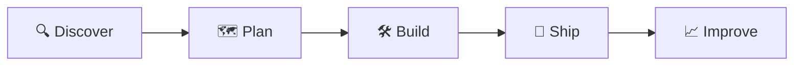

<p align="center">
  
</p>

<p align="center">
  <a href="https://linkedin.com/in/josh-dolby"></a>
  <a href="https://apexinfinitysolutions.com"></a>
</p>

---

## 👨‍💻 About Me

```js
const josh = {
  role: "Delivery Manager",
  company: "Apex Infinity Solutions",
  journey: "Electrician → Developer → Solutions Engineer → Delivery Manager",
  delivery: [
    "Agile Delivery (Scrum / Kanban)",
    "Stakeholder Management",
    "Roadmaps, Risk & Dependencies",
    "Sprint & Release Management",
    "Team Enablement"
  ],
  technical: [
    "Salesforce (Apex, LWC, Automation)",
    "API & Integration Engineering",
    "Cloud Architecture",
    "System Design",
    "Full-Stack Development"
  ],
  motto: "On time. On scope. Intentional."
};
```

I lead delivery of Salesforce, cloud and integration projects at **Apex Infinity Solutions**. My route here is a little different. I started on the tools as an electrician, retrained as a software developer, and moved into solutions engineering before stepping up to lead delivery.

That path shapes how I work: plan it properly, build it safely, and don't sign it off until it works. I can talk roadmaps with stakeholders and still review an Apex trigger with the team.



---

## 🧭 How I Deliver



| Stage | What it means |
|:--|:--|
| 🔍 **Discover** | Understand the real problem, the people, and what success looks like |
| 🗺️ **Plan** | Clear scope, a realistic roadmap, and risks surfaced early |
| 🛠️ **Build** | Short iterations, tight feedback loops, and no surprises |
| 🚀 **Ship** | Controlled releases with quality built in, not bolted on |
| 📈 **Improve** | Measure, run retros, refine, and go again |

---

## 🚀 What I Bring

<table>
<tr>
<td width="50%" valign="top">

**📋 Delivery**
- Sprint, release & programme management
- Stakeholder alignment & clear communication
- Risk, dependency & scope control
- Turning business needs into technical plans
- Building focused, high-trust teams

</td>
<td width="50%" valign="top">

**⚙️ Engineering**
- Salesforce architecture (Apex, LWC, Flow)
- API & integration design (MuleSoft, REST, GraphQL)
- Cloud & serverless (AWS, Heroku)
- Full-stack web (React, Node, TypeScript)
- Real-time systems in Unreal Engine & C++

</td>
</tr>
</table>

---

## 🛠 Core Stack


### 📋 Delivery Toolkit


<details>
<summary><b>🧰 Full technical stack</b></summary>
<br/>

**Languages & Databases**


**Frameworks & Platforms**


**Dev Tools**


</details>

---

## 📊 GitHub Activity

<p align="center">
  
  
</p>

---

## 🎮 Off the Clock

- 🎮 Building interactive games & simulations in Unreal Engine
- 🤖 Exploring AI & automation workflows
- ⚽ Football, 🎵 music, and Monster ;) ☕

---

<p align="center">
  <i>"Good systems are invisible. Great systems are intentional."</i>
</p>


